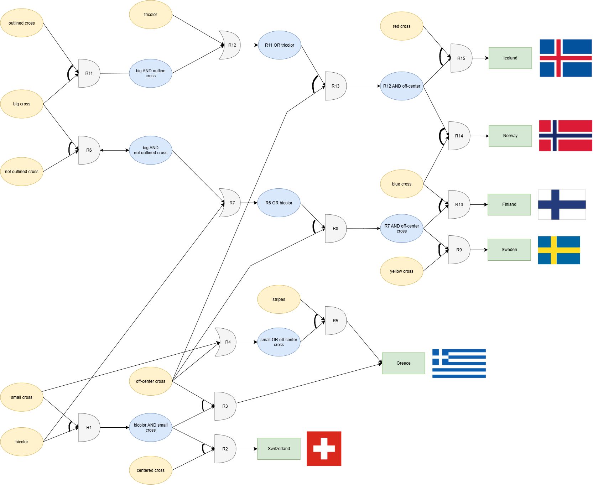

Fundamentele Inteligentei Artificiale Course

Lab1: Expert (hopefully) Systems

Raw version, improve later


Task 1

I read that we could switch the topic so i decided to do Flags because there is many of them so that means there are some which share none, some and a lot of features

I choose {specify the countries}, because all of the have crosses and different types of them so i thought it would help me have the 3rd type of question (besides tes/no, select one, to have a select many attributes of the cross).

I grouped them in several classes stating what they have in common all then creating a new class, this way i created the goal tree, then i was checking for new ways to describe a flag and got the OR nodes

{show report_related/forward checking}

Task 3

(below i forgot to use english please translate)

Am introdus regulile mele si le-am testat cu 

python test_task_2.py

cu acest parametru

#Sweden
FLAG_DATA = (
     'flag is bicolor',
     'flag is off-center cross',
     'flag is yellow cross'
 )
 

 mi-a dat raspunsul corect

 Rule: IF(OR('(?x) is small cross', '(?x) is off-center cross'), THEN('(?x) is small cross or off-center cross'))
Added: flag is small cross or off-center cross
Rule: IF(OR('(?x) is big cross and not outlined cross', '(?x) is bicolor'), THEN('(?x) is big cross and not outlined cross or bicolor'))
Added: flag is big cross and not outlined cross or bicolor
Rule: IF(AND('(?x) is big cross and not outlined cross or bicolor', '(?x) is off-center cross'), THEN('(?x) is big cross and not outlined cross or bicolor and off-center cross'))
Added: flag is big cross and not outlined cross or bicolor and off-center cross
Rule: IF(AND('(?x) is big cross and not outlined cross or bicolor and off-center cross', '(?x) is yellow cross'), THEN('(?x) is Sweden'))
Added: flag is Sweden

--- Final Inferred Facts ---
flag is Sweden
flag is bicolor
flag is big cross and not outlined cross or bicolor
flag is big cross and not outlined cross or bicolor and off-center cross
flag is off-center cross
flag is small cross or off-center cross
flag is yellow cross

{show report_related/forward checking illustration}


task 4

i implemented the BC

here are example outputs

```text
--- Resulting Goal Tree for flag is Greece ---
OR:
  AND:
    - flag is small cross
    - flag is bicolor
    - flag is off-center cross
  AND:
    OR:
      - flag is small cross
      - flag is off-center cross
    - flag has stripes
```

```text
--- Resulting Goal Tree for flag is Iceland ---
AND:
  OR:
    AND:
      - flag is outlined cross
      - flag is big cross
    - flag is tricolor
  - flag is off-center cross
  - flag is red cross
  ```