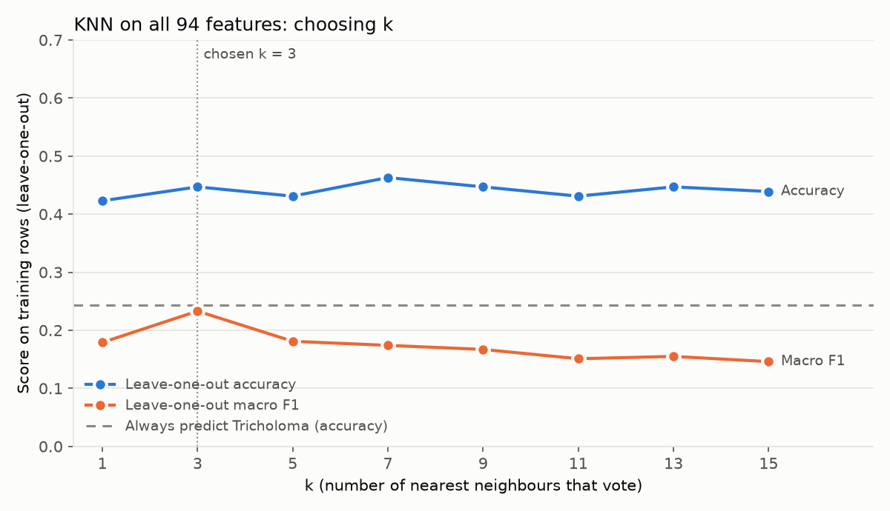

# Task 2.5 KNN on all 94 features

Inputs: the 94 encoded columns from Task 2.4 (123 training and 50 test mushrooms). Euclidean distance, equal votes, tied votes go to the alphabetically first family.

## Choosing k (leave-one-out on the training rows)

| k | Accuracy | Macro F1 | Correct |
| --- | --- | --- | --- |
| 1 | 0.423 | 0.179 | 52 |
| 3 | 0.447 | 0.233 | 55 |
| 5 | 0.431 | 0.181 | 53 |
| 7 | 0.463 | 0.174 | 57 |
| 9 | 0.447 | 0.167 | 55 |
| 11 | 0.431 | 0.151 | 53 |
| 13 | 0.447 | 0.155 | 55 |
| 15 | 0.439 | 0.146 | 54 |

Chosen k = **3** (highest leave-one-out macro F1; ties go to the smaller k). Always predicting `Tricholoma Family` scores 0.244 leave-one-out accuracy.

## Results

| Data | Mushrooms | Correctly classified | Accuracy |
| --- | --- | --- | --- |
| Training, each mushroom predicted from the other 122 (leave-one-out) | 123 | 55 | 44.7% |
| Training, mushroom itself included among the neighbours | 123 | 80 | 65.0% |
| Test (never seen) | 50 | 27 | 54.0% |

Test macro F1: 0.396. Always predicting `Tricholoma Family` on test: accuracy 0.260, macro F1 0.024.

## Clear versus tied votes on the test set

| Vote | Test mushrooms | Correct | Accuracy |
| --- | --- | --- | --- |
| Clear majority | 26 | 20 | 76.9% |
| Tied (decided alphabetically) | 24 | 7 | 29.2% |

## Example: nearest neighbours of test mushroom `The Blusher` (Amanita Family)

| Neighbour | Family | Distance |
| --- | --- | --- |
| False Panther Cap | Amanita Family | 2.238 |
| Shaggy Parasol | Lepiota Family | 2.65 |
| Bare-toothed Russula | Russula Family | 2.834 |

Prediction: **Amanita Family** (correct).

## Per-family test scores

| Family | Test support | Precision | Recall | F1 |
| --- | --- | --- | --- | --- |
| Amanita Family | 2 | 0.333 | 1.0 | 0.5 |
| Bolbitius Family | 1 | 0.0 | 0.0 | 0.0 |
| Bolete Family | 4 | 0.333 | 1.0 | 0.5 |
| Bracket Fungi | 2 | 1.0 | 1.0 | 1.0 |
| Chanterelle Family | 1 | 1.0 | 1.0 | 1.0 |
| Cortinarius Family | 3 | 0.2 | 0.333 | 0.25 |
| Entoloma Family | 2 | 0.4 | 1.0 | 0.571 |
| Ink Cap Family | 4 | 0.6 | 0.75 | 0.667 |
| Lepiota Family | 1 | 0.0 | 0.0 | 0.0 |
| Mushroom Family | 2 | 1.0 | 1.0 | 1.0 |
| Oyster Mushroom Family | 1 | 0.0 | 0.0 | 0.0 |
| Paxillus Family | 1 | 0.0 | 0.0 | 0.0 |
| Pluteus Family | 1 | 0.0 | 0.0 | 0.0 |
| Russula Family | 8 | 0.833 | 0.625 | 0.714 |
| Stropharia Family | 2 | 0.0 | 0.0 | 0.0 |
| Tricholoma Family | 13 | 0.833 | 0.385 | 0.526 |
| Wax Gill Family | 2 | 0.0 | 0.0 | 0.0 |
