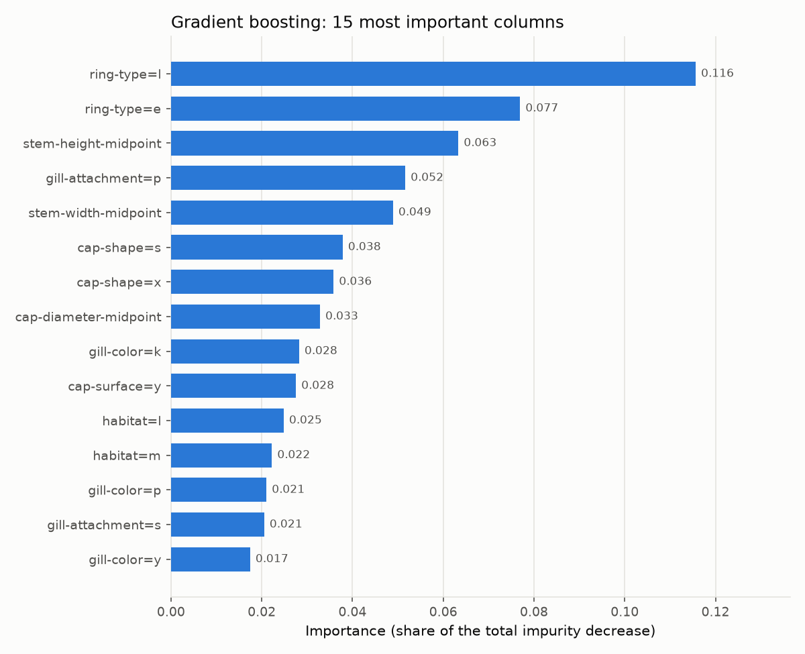

# Task 3.2 Gradient boosting

Learning rate 0.1, subsample 0.8; inputs: the 94 encoded columns from Task 2.4. Settings chosen by leave-one-out macro F1 on the training rows.

## Choosing the settings (leave-one-out on the training rows)

| n_estimators | max_depth | Accuracy | Macro F1 | Correct |
| --- | --- | --- | --- | --- |
| 100 | 2 | 0.472 | 0.213 | 58 |
| 100 | 3 | 0.472 | 0.214 | 58 |
| 200 | 2 | 0.48 | 0.212 | 59 |
| 200 | 3 | 0.463 | 0.191 | 57 |

Chosen: **n_estimators=100, max_depth=3**.

## Results

| Data | Mushrooms | Correctly classified | Accuracy |
| --- | --- | --- | --- |
| Training, each mushroom predicted from the other 122 (leave-one-out) | 123 | 58 | 47.2% |
| Training, model fitted on all 123 and asked about the same mushrooms | 123 | 122 | 99.2% |
| Test (never seen) | 50 | 26 | 52.0% |

Test macro F1: 0.277.

## Comparison with the earlier models (same 50 test mushrooms)

| Model | Test accuracy | Test macro F1 |
| --- | --- | --- |
| Always predict Tricholoma | 26.0% (13/50) | 0.024 |
| Disorder tree (Task 2.3) | 30.0% (15/50) | 0.190 |
| KNN, k = 3 (Task 2.5) | 54.0% (27/50) | 0.396 |
| Random forest (Task 3.1) | 66.0% (33/50) | 0.494 |
| **Gradient boosting (Task 3.2)** | 52.0% (26/50) | 0.277 |

## Feature importance

Importance = how much a column reduced the error across all boosting trees (the values sum to 1). It is biased towards columns with many possible split points (the numeric columns) and does not say in which direction a column pushes the prediction.

| Column | Importance |
| --- | --- |
| ring-type=l | 0.1156 |
| ring-type=e | 0.0769 |
| stem-height-midpoint | 0.0633 |
| gill-attachment=p | 0.0516 |
| stem-width-midpoint | 0.0489 |
| cap-shape=s | 0.0378 |
| cap-shape=x | 0.0358 |
| cap-diameter-midpoint | 0.0328 |
| gill-color=k | 0.0282 |
| cap-surface=y | 0.0275 |
| habitat=l | 0.0248 |
| habitat=m | 0.0222 |
| gill-color=p | 0.021 |
| gill-attachment=s | 0.0205 |
| gill-color=y | 0.0174 |

Summed per original feature:

| Original feature | Importance |
| --- | --- |
| ring-type | 0.2096 |
| gill-color | 0.1141 |
| cap-shape | 0.1062 |
| gill-attachment | 0.0969 |
| cap-surface | 0.0732 |
| habitat | 0.07 |
| stem-height-midpoint | 0.0633 |
| cap-color | 0.0564 |
| stem-width-midpoint | 0.0489 |
| stem-color | 0.0431 |
| stem-surface | 0.0396 |
| cap-diameter-midpoint | 0.0328 |
| season | 0.0187 |
| does-bruise-or-bleed | 0.0173 |
| gill-spacing | 0.0055 |
| has-ring | 0.0045 |

## Per-family test scores

| Family | Test support | Precision | Recall | F1 |
| --- | --- | --- | --- | --- |
| Amanita Family | 2 | 0.0 | 0.0 | 0.0 |
| Bolbitius Family | 1 | 0.0 | 0.0 | 0.0 |
| Bolete Family | 4 | 1.0 | 1.0 | 1.0 |
| Bracket Fungi | 2 | 0.0 | 0.0 | 0.0 |
| Chanterelle Family | 1 | 0.0 | 0.0 | 0.0 |
| Cortinarius Family | 3 | 0.5 | 0.333 | 0.4 |
| Crepidotus Family | 0 | 0.0 | 0.0 | 0.0 |
| Entoloma Family | 2 | 0.333 | 0.5 | 0.4 |
| Ink Cap Family | 4 | 0.5 | 0.5 | 0.5 |
| Lepiota Family | 1 | 0.0 | 0.0 | 0.0 |
| Mushroom Family | 2 | 1.0 | 0.5 | 0.667 |
| Oyster Mushroom Family | 1 | 0.0 | 0.0 | 0.0 |
| Paxillus Family | 1 | 0.0 | 0.0 | 0.0 |
| Pluteus Family | 1 | 0.0 | 0.0 | 0.0 |
| Russula Family | 8 | 0.462 | 0.75 | 0.571 |
| Stropharia Family | 2 | 0.667 | 1.0 | 0.8 |
| Tricholoma Family | 13 | 0.6 | 0.692 | 0.643 |
| Wax Gill Family | 2 | 0.0 | 0.0 | 0.0 |
