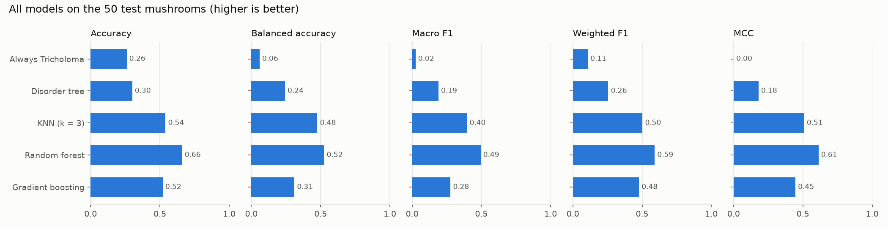
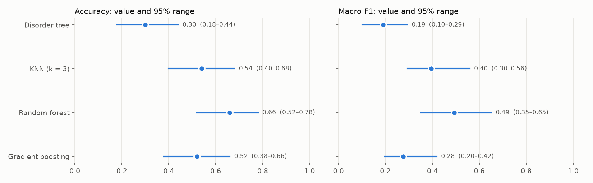
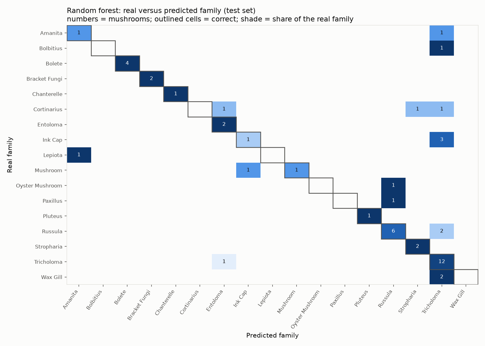

# Task 4.1 Comparison of all models (50 test mushrooms)

## All metrics

| Model | Correct | Accuracy | Balanced accuracy | Macro F1 | Weighted F1 | MCC |
| --- | --- | --- | --- | --- | --- | --- |
| Always Tricholoma | 13/50 | 0.26 | 0.059 | 0.024 | 0.107 | 0.0 |
| Disorder tree | 15/50 | 0.3 | 0.242 | 0.19 | 0.256 | 0.179 |
| KNN (k = 3) | 27/50 | 0.54 | 0.476 | 0.396 | 0.502 | 0.509 |
| Random forest | 33/50 | 0.66 | 0.525 | 0.494 | 0.59 | 0.613 |
| Gradient boosting | 26/50 | 0.52 | 0.31 | 0.277 | 0.477 | 0.446 |

## 95% ranges (bootstrap, 2000 resamples of the test set)

| Model | Accuracy (95% range) | Macro F1 (95% range) |
| --- | --- | --- |
| Always Tricholoma | 0.260 (0.140 to 0.380) | 0.024 (0.016 to 0.044) |
| Disorder tree | 0.300 (0.180 to 0.440) | 0.190 (0.101 to 0.293) |
| KNN (k = 3) | 0.540 (0.400 to 0.680) | 0.396 (0.295 to 0.559) |
| Random forest | 0.660 (0.520 to 0.780) | 0.494 (0.353 to 0.651) |
| Gradient boosting | 0.520 (0.380 to 0.660) | 0.277 (0.198 to 0.418) |

## Is Random forest clearly better? (paired bootstrap differences)

| Comparison | Metric | Difference | 95% range | Clear difference? |
| --- | --- | --- | --- | --- |
| Random forest minus Always Tricholoma | Accuracy | 0.399 | +0.240 to +0.560 | yes |
| Random forest minus Always Tricholoma | Macro F1 | 0.47 | +0.321 to +0.618 | yes |
| Random forest minus Disorder tree | Accuracy | 0.357 | +0.180 to +0.520 | yes |
| Random forest minus Disorder tree | Macro F1 | 0.304 | +0.151 to +0.461 | yes |
| Random forest minus KNN (k = 3) | Accuracy | 0.118 | -0.040 to +0.280 | no (range includes 0) |
| Random forest minus KNN (k = 3) | Macro F1 | 0.083 | -0.066 to +0.220 | no (range includes 0) |
| Random forest minus Gradient boosting | Accuracy | 0.139 | +0.000 to +0.280 | no (range includes 0) |
| Random forest minus Gradient boosting | Macro F1 | 0.201 | +0.066 to +0.332 | yes |

## Test mushrooms found per family (recall as found / total)

| Family | Mushrooms in dataset | Test mushrooms | Always Tricholoma | Disorder tree | KNN (k = 3) | Random forest | Gradient boosting |
| --- | --- | --- | --- | --- | --- | --- | --- |
| Tricholoma | 43 | 13 | 13/13 | 8/13 | 5/13 | 12/13 | 9/13 |
| Russula | 27 | 8 | 0/8 | 0/8 | 5/8 | 6/8 | 6/8 |
| Bolete | 14 | 4 | 0/4 | 0/4 | 4/4 | 4/4 | 4/4 |
| Ink Cap | 13 | 4 | 0/4 | 2/4 | 3/4 | 1/4 | 2/4 |
| Cortinarius | 11 | 3 | 0/3 | 0/3 | 1/3 | 0/3 | 1/3 |
| Amanita | 8 | 2 | 0/2 | 1/2 | 2/2 | 1/2 | 0/2 |
| Stropharia | 8 | 2 | 0/2 | 0/2 | 0/2 | 2/2 | 2/2 |
| Wax Gill | 8 | 2 | 0/2 | 0/2 | 0/2 | 0/2 | 0/2 |
| Bracket Fungi | 7 | 2 | 0/2 | 2/2 | 2/2 | 2/2 | 0/2 |
| Entoloma | 7 | 2 | 0/2 | 1/2 | 2/2 | 2/2 | 1/2 |
| Mushroom | 5 | 2 | 0/2 | 0/2 | 2/2 | 1/2 | 1/2 |
| Bolbitius | 3 | 1 | 0/1 | 0/1 | 0/1 | 0/1 | 0/1 |
| Chanterelle | 3 | 1 | 0/1 | 0/1 | 1/1 | 1/1 | 0/1 |
| Lepiota | 3 | 1 | 0/1 | 0/1 | 0/1 | 0/1 | 0/1 |
| Paxillus | 3 | 1 | 0/1 | 0/1 | 0/1 | 0/1 | 0/1 |
| Oyster Mushroom | 2 | 1 | 0/1 | 0/1 | 0/1 | 0/1 | 0/1 |
| Pluteus | 2 | 1 | 0/1 | 1/1 | 0/1 | 1/1 | 0/1 |

## Accuracy by family size

| Family size group | Families | Test mushrooms | Always Tricholoma | Disorder tree | KNN (k = 3) | Random forest | Gradient boosting |
| --- | --- | --- | --- | --- | --- | --- | --- |
| Large (13–43 mushrooms) | 4 | 29 | 13/29 (45%) | 10/29 (34%) | 17/29 (59%) | 23/29 (79%) | 21/29 (72%) |
| Medium (5–11) | 7 | 15 | 0/15 (0%) | 4/15 (27%) | 9/15 (60%) | 8/15 (53%) | 5/15 (33%) |
| Small (2–3) | 6 | 6 | 0/6 (0%) | 1/6 (17%) | 1/6 (17%) | 2/6 (33%) | 0/6 (0%) |

## Accuracy by rarity tier (Step 1.10)

| Tier | Test mushrooms | Always Tricholoma | Disorder tree | KNN (k = 3) | Random forest | Gradient boosting |
| --- | --- | --- | --- | --- | --- | --- |
| Common | 40 | 10/40 | 10/40 | 20/40 | 27/40 | 22/40 |
| Rare | 9 | 2/9 | 4/9 | 6/9 | 5/9 | 4/9 |
| Legendary | 1 | 1/1 | 1/1 | 1/1 | 1/1 | 0/1 |

## Confusion matrix of Random forest

