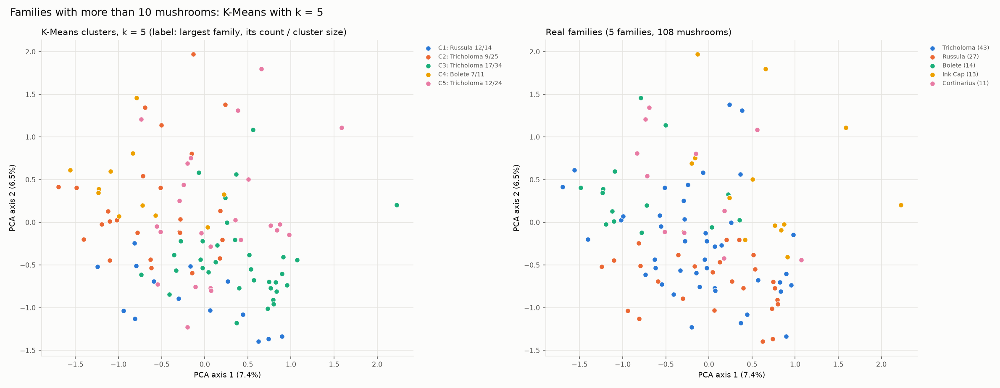
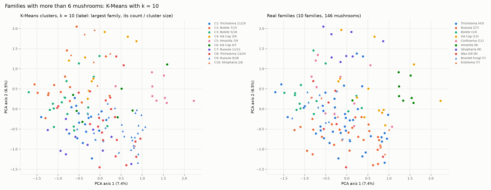
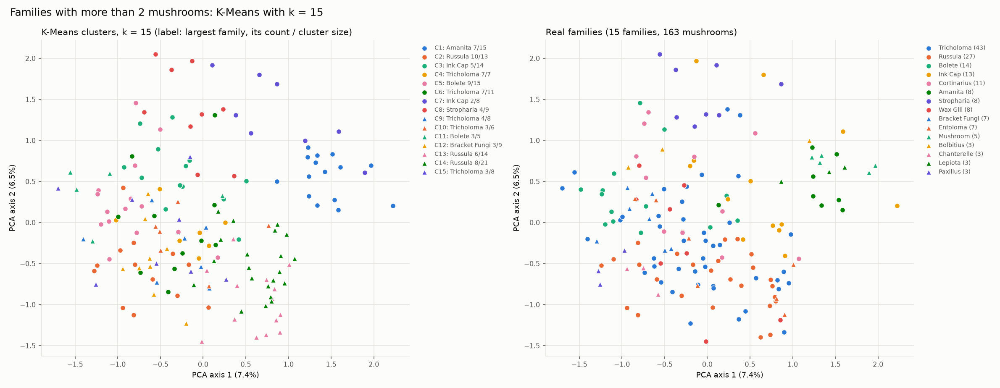
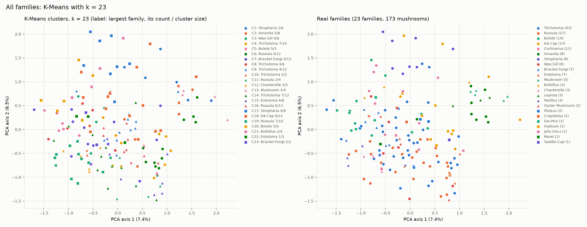

# Task 5.1 K-Means with k = number of families, on subsets of families

| Families included | Families = k | Mushrooms | Purity | Family togetherness | Families that are the largest in some cluster |
| --- | --- | --- | --- | --- | --- |
| more than 10 mushrooms | 5 | 108 | 0.528 | 0.516 | 3 of 5 |
| more than 6 mushrooms | 10 | 146 | 0.493 | 0.413 | 6 of 10 |
| more than 2 mushrooms | 15 | 163 | 0.497 | 0.563 | 7 of 15 |
| all families | 23 | 173 | 0.549 | 0.654 | 12 of 23 |

## k = 5 (more than 10 mushrooms, 108 mushrooms)

| Family (mushrooms) | C1 | C2 | C3 | C4 | C5 |
| --- | --- | --- | --- | --- | --- |
| Tricholoma (43) | 2 | **9** | **17** | 3 | **12** |
| Russula (27) | **12** | 3 | 12 | 0 | 0 |
| Bolete (14) | 0 | 6 | 0 | **7** | 1 |
| Ink Cap (13) | 0 | 1 | 3 | 0 | 9 |
| Cortinarius (11) | 0 | 6 | 2 | 1 | 2 |
| **Cluster size** | 14 | 25 | 34 | 11 | 24 |

## k = 10 (more than 6 mushrooms, 146 mushrooms)

| Family (mushrooms) | C1 | C2 | C3 | C4 | C5 | C6 | C7 | C8 | C9 | C10 |
| --- | --- | --- | --- | --- | --- | --- | --- | --- | --- | --- |
| Tricholoma (43) | **11** | 1 | 4 | 1 | 1 | 1 | 0 | **13** | **9** | **2** |
| Russula (27) | 1 | 0 | 2 | 0 | 0 | 0 | **11** | 4 | **9** | 0 |
| Bolete (14) | 1 | **7** | **5** | 0 | 0 | 0 | 0 | 0 | 1 | 0 |
| Ink Cap (13) | 0 | 0 | 0 | **3** | 1 | **4** | 0 | 1 | 3 | 1 |
| Cortinarius (11) | 1 | 2 | 2 | 1 | 0 | 0 | 0 | 1 | 3 | 1 |
| Amanita (8) | 0 | 0 | 0 | 0 | **7** | 0 | 0 | 1 | 0 | 0 |
| Stropharia (8) | 0 | 2 | 1 | **3** | 0 | 0 | 0 | 0 | 0 | **2** |
| Wax Gill (8) | 0 | 1 | 2 | 1 | 0 | 0 | 0 | 3 | 1 | 0 |
| Bracket Fungi (7) | 2 | 2 | 1 | 0 | 0 | 2 | 0 | 0 | 0 | 0 |
| Entoloma (7) | 3 | 0 | 1 | 0 | 0 | 0 | 0 | 1 | 2 | 0 |
| **Cluster size** | 19 | 15 | 18 | 9 | 9 | 7 | 11 | 24 | 28 | 6 |

## k = 15 (more than 2 mushrooms, 163 mushrooms)

| Family (mushrooms) | C1 | C2 | C3 | C4 | C5 | C6 | C7 | C8 | C9 | C10 | C11 | C12 | C13 | C14 | C15 |
| --- | --- | --- | --- | --- | --- | --- | --- | --- | --- | --- | --- | --- | --- | --- | --- |
| Tricholoma (43) | 0 | 0 | 1 | **7** | 0 | **7** | 1 | 3 | **4** | **3** | 1 | **3** | 3 | 7 | **3** |
| Russula (27) | 0 | **10** | 0 | 0 | 2 | 0 | 0 | 0 | 0 | 0 | 0 | 0 | **6** | **8** | 1 |
| Bolete (14) | 0 | 0 | 0 | 0 | **9** | 0 | 0 | 0 | 1 | 0 | **3** | 0 | 0 | 1 | 0 |
| Ink Cap (13) | 1 | 0 | **5** | 0 | 0 | 0 | **2** | 1 | 0 | 1 | 0 | 0 | 0 | 3 | 0 |
| Cortinarius (11) | 0 | 0 | 3 | 0 | 1 | 1 | 1 | 1 | 0 | 1 | 0 | 0 | 0 | 2 | 1 |
| Amanita (8) | **7** | 0 | 0 | 0 | 0 | 1 | 0 | 0 | 0 | 0 | 0 | 0 | 0 | 0 | 0 |
| Stropharia (8) | 0 | 0 | 1 | 0 | 0 | 1 | **2** | **4** | 0 | 0 | 0 | 0 | 0 | 0 | 0 |
| Wax Gill (8) | 0 | 0 | 2 | 0 | 1 | 1 | 0 | 0 | 0 | 0 | 0 | 0 | 2 | 0 | 2 |
| Bracket Fungi (7) | 0 | 1 | 0 | 0 | 1 | 0 | 0 | 0 | 0 | 1 | 1 | **3** | 0 | 0 | 0 |
| Entoloma (7) | 0 | 0 | 0 | 0 | 1 | 0 | 0 | 0 | 3 | 0 | 0 | 0 | 3 | 0 | 0 |
| Mushroom (5) | 4 | 0 | 0 | 0 | 0 | 0 | 1 | 0 | 0 | 0 | 0 | 0 | 0 | 0 | 0 |
| Bolbitius (3) | 0 | 0 | 2 | 0 | 0 | 0 | 1 | 0 | 0 | 0 | 0 | 0 | 0 | 0 | 0 |
| Chanterelle (3) | 0 | 0 | 0 | 0 | 0 | 0 | 0 | 0 | 0 | 0 | 0 | **3** | 0 | 0 | 0 |
| Lepiota (3) | 3 | 0 | 0 | 0 | 0 | 0 | 0 | 0 | 0 | 0 | 0 | 0 | 0 | 0 | 0 |
| Paxillus (3) | 0 | 2 | 0 | 0 | 0 | 0 | 0 | 0 | 0 | 0 | 0 | 0 | 0 | 0 | 1 |
| **Cluster size** | 15 | 13 | 14 | 7 | 15 | 11 | 8 | 9 | 8 | 6 | 5 | 9 | 14 | 21 | 8 |

## k = 23 (all families, 173 mushrooms)

| Family (mushrooms) | C1 | C2 | C3 | C4 | C5 | C6 | C7 | C8 | C9 | C10 | C11 | C12 | C13 | C14 | C15 | C16 | C17 | C18 | C19 | C20 | C21 | C22 | C23 |
| --- | --- | --- | --- | --- | --- | --- | --- | --- | --- | --- | --- | --- | --- | --- | --- | --- | --- | --- | --- | --- | --- | --- | --- |
| Tricholoma (43) | 0 | 1 | 1 | **7** | 0 | 3 | 3 | **4** | **4** | **2** | 0 | 0 | 0 | **7** | 1 | 2 | 2 | 3 | 1 | 1 | 0 | **1** | 0 |
| Russula (27) | 0 | 2 | 0 | 1 | 0 | **4** | 0 | 0 | 0 | 0 | **2** | **2** | 0 | 0 | 3 | **6** | 0 | 0 | **7** | 0 | 0 | 0 | 0 |
| Bolete (14) | 0 | 0 | 0 | 0 | **5** | 0 | 0 | 1 | 3 | 0 | 0 | 0 | 0 | 0 | 0 | 0 | 0 | 0 | 0 | **5** | 0 | 0 | 0 |
| Ink Cap (13) | 0 | 0 | 0 | 1 | 0 | 1 | 0 | 0 | 0 | 0 | 0 | 0 | 1 | 0 | 0 | 0 | 1 | **9** | 0 | 0 | 0 | 0 | 0 |
| Cortinarius (11) | 1 | 0 | 0 | 1 | 0 | 0 | 0 | 1 | 1 | 0 | 0 | 0 | 0 | 1 | 0 | 4 | 1 | 1 | 0 | 0 | 0 | 0 | 0 |
| Amanita (8) | 0 | **5** | 0 | 0 | 0 | 3 | 0 | 0 | 0 | 0 | 0 | 0 | 0 | 0 | 0 | 0 | 0 | 0 | 0 | 0 | 0 | 0 | 0 |
| Stropharia (8) | **2** | 0 | 0 | 0 | 0 | 0 | 0 | 0 | 0 | 0 | 0 | 0 | 0 | 0 | 0 | 0 | **4** | 0 | 0 | 0 | **2** | 0 | 0 |
| Wax Gill (8) | 0 | 0 | **4** | 0 | 0 | 0 | 0 | 0 | 0 | 0 | **2** | 0 | 0 | 1 | 0 | 0 | 0 | 0 | 0 | 0 | 0 | **1** | 0 |
| Bracket Fungi (7) | 0 | 0 | 0 | 0 | 0 | 0 | **4** | 0 | 0 | 0 | 0 | 0 | 0 | 1 | 0 | 0 | 0 | 0 | 0 | 0 | 0 | 0 | **2** |
| Entoloma (7) | 0 | 0 | 0 | 0 | 0 | 0 | 0 | 0 | 1 | 0 | 0 | 0 | 0 | 1 | **4** | 0 | 0 | 0 | 0 | 0 | 0 | **1** | 0 |
| Mushroom (5) | 1 | 0 | 0 | 0 | 0 | 0 | 0 | 0 | 1 | 0 | 0 | 0 | **3** | 0 | 0 | 0 | 0 | 0 | 0 | 0 | 0 | 0 | 0 |
| Bolbitius (3) | 1 | 0 | 0 | 0 | 0 | 0 | 0 | 0 | 0 | 0 | 0 | 0 | 0 | 0 | 0 | 0 | 0 | 0 | 0 | 0 | **2** | 0 | 0 |
| Chanterelle (3) | 0 | 0 | 0 | 0 | 0 | 0 | 1 | 0 | 0 | 0 | 0 | **2** | 0 | 0 | 0 | 0 | 0 | 0 | 0 | 0 | 0 | 0 | 0 |
| Lepiota (3) | 1 | 0 | 0 | 0 | 0 | 1 | 1 | 0 | 0 | 0 | 0 | 0 | 0 | 0 | 0 | 0 | 0 | 0 | 0 | 0 | 0 | 0 | 0 |
| Paxillus (3) | 0 | 0 | 1 | 0 | 0 | 0 | 0 | 0 | 0 | 0 | 0 | 0 | 0 | 0 | 0 | 0 | 0 | 0 | 2 | 0 | 0 | 0 | 0 |
| Oyster Mushroom (2) | 0 | 0 | 0 | 0 | 0 | 0 | 1 | 0 | 0 | 0 | 0 | 0 | 0 | 1 | 0 | 0 | 0 | 0 | 0 | 0 | 0 | 0 | 0 |
| Pluteus (2) | 0 | 0 | 0 | 0 | 0 | 0 | 0 | 0 | 2 | 0 | 0 | 0 | 0 | 0 | 0 | 0 | 0 | 0 | 0 | 0 | 0 | 0 | 0 |
| Crepidotus (1) | 0 | 0 | 0 | 0 | 0 | 0 | 1 | 0 | 0 | 0 | 0 | 0 | 0 | 0 | 0 | 0 | 0 | 0 | 0 | 0 | 0 | 0 | 0 |
| Ear-Pick (1) | 0 | 0 | 0 | 0 | 0 | 0 | 0 | 0 | 0 | 0 | 0 | 0 | 0 | 0 | 0 | 0 | 0 | 1 | 0 | 0 | 0 | 0 | 0 |
| Hydnum (1) | 0 | 0 | 0 | 0 | 0 | 0 | 0 | 0 | 0 | 0 | 0 | 0 | 0 | 0 | 0 | 1 | 0 | 0 | 0 | 0 | 0 | 0 | 0 |
| Jelly Discs (1) | 0 | 0 | 0 | 0 | 0 | 0 | 0 | 0 | 0 | 0 | 0 | 1 | 0 | 0 | 0 | 0 | 0 | 0 | 0 | 0 | 0 | 0 | 0 |
| Morel (1) | 0 | 0 | 0 | 0 | 0 | 0 | 1 | 0 | 0 | 0 | 0 | 0 | 0 | 0 | 0 | 0 | 0 | 0 | 0 | 0 | 0 | 0 | 0 |
| Saddle-Cup (1) | 0 | 0 | 0 | 0 | 0 | 0 | 1 | 0 | 0 | 0 | 0 | 0 | 0 | 0 | 0 | 0 | 0 | 0 | 0 | 0 | 0 | 0 | 0 |
| **Cluster size** | 6 | 8 | 6 | 10 | 5 | 12 | 13 | 6 | 12 | 2 | 4 | 5 | 4 | 12 | 8 | 13 | 8 | 14 | 10 | 6 | 4 | 3 | 2 |
